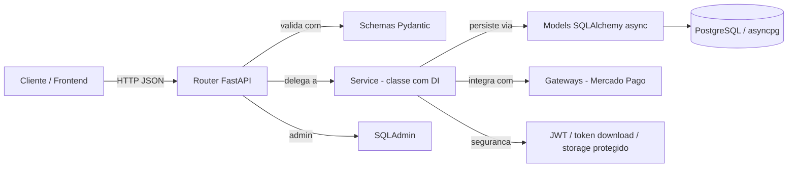
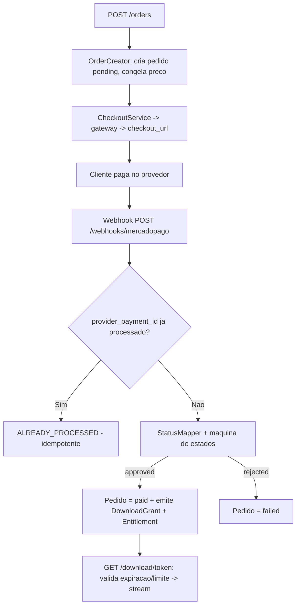

# Fluxograma — Backend (requisição e camadas)

> Trilha flowcharts · e_seller · 2026-06-07

## Camadas de uma requisição

## Fluxo crítico — compra → pagamento → entrega

> Detalhes: [`../unit/backend/`](../unit/backend/) e [`../planning/08-arquitetura.md`](../planning/08-arquitetura.md).
