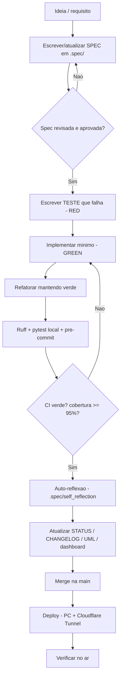

# Fluxograma — Processo de Desenvolvimento (SDD + TDD)

> Trilha flowcharts · e_seller · 2026-06-07

> Regra de ouro: **nenhuma linha de código sem spec e sem teste que a justifique**
> (ver [`../standards/`](../standards/) e [`../planning/17-fluxo-sdd.md`](../planning/17-fluxo-sdd.md)).
