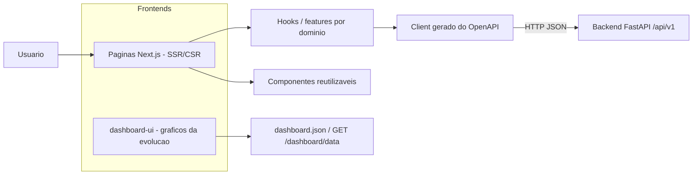
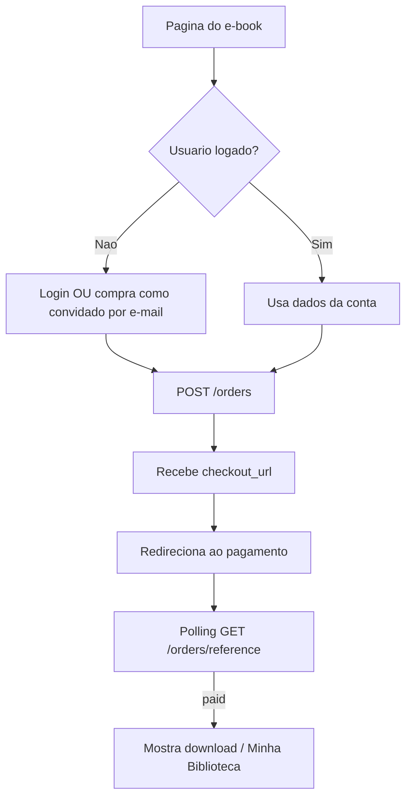

# Fluxograma — Frontend (Next.js)

> Trilha flowcharts · e_seller · 2026-06-07

## Arquitetura / dados

## Fluxo de uma ação (ex.: comprar)

> Convenções: [`../frontend/conventions.md`](../frontend/conventions.md).
