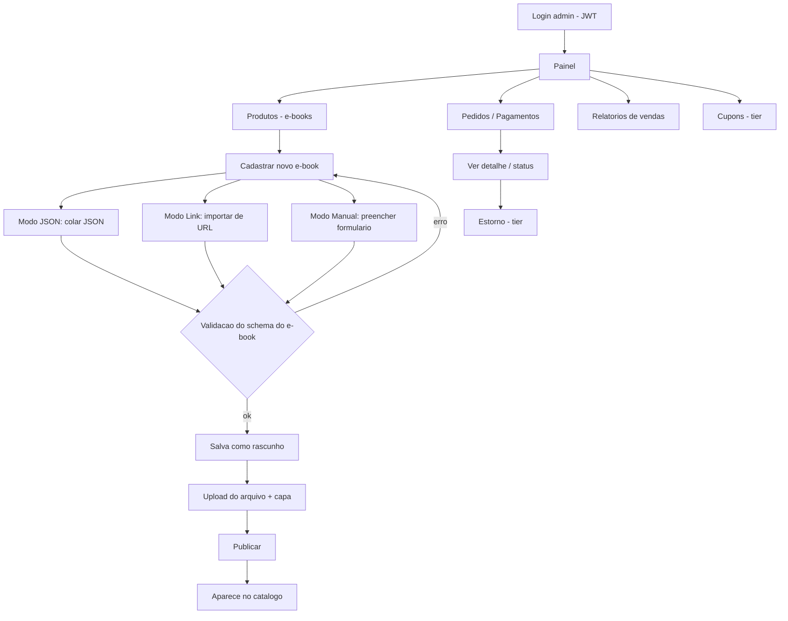

# Fluxograma — Navegação do Vendedor/Admin

> Trilha flowcharts · e_seller · 2026-06-07

> O **produto é sempre um e-book** (schema fixo). O cadastro é **dinâmico** com 3 modos
> de entrada (JSON / link / manual) — ver requisito em [`../checklist.md`](../checklist.md)
> e a unit [`../unit/backend/catalog/service_create_product.md`](../unit/backend/catalog/service_create_product.md).
