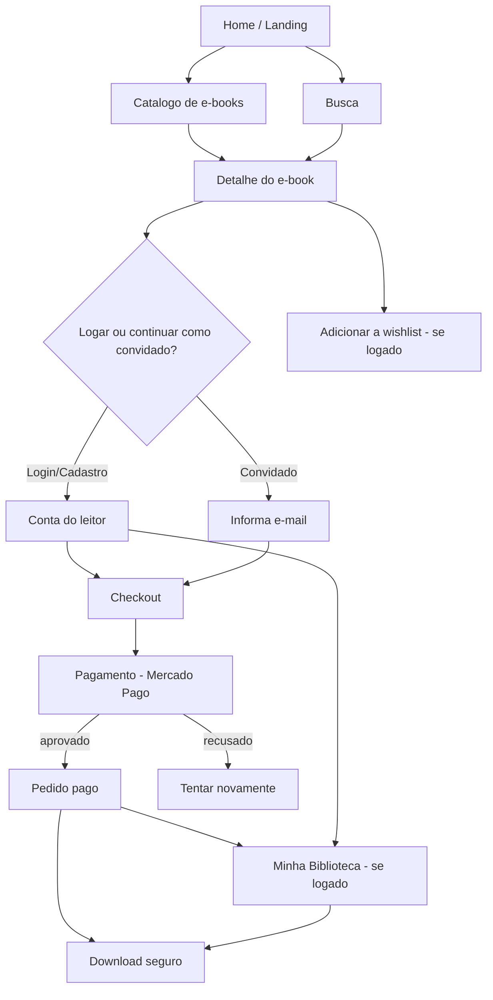

# Fluxograma — Navegação do Cliente (comprador)

> Trilha flowcharts · e_seller · 2026-06-07

> Inclui os requisitos novos: **home/landing** e **login do comprador** (opcional;
> compra como convidado continua possível). Biblioteca/wishlist exigem login.
