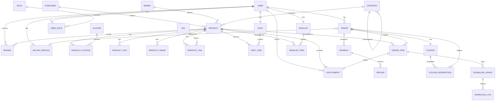

# Unit: schema_overview — Entidades e Relações (visão completa)

> Tipo: `db` / design · Área: `db`
> Deriva de: [`planning/09`](../../planning/09-modelo-de-dominio.md),
> [`planning/10`](../../planning/10-modelo-de-dados.md) · Status: **Rascunho (em discussão)**

> Este documento é o **desenho de DB com visão de longo prazo** ("objetivo final"),
> não apenas o MVP. Ele **expande** o modelo congelado de `planning/10` (que era o
> recorte do MVP). Cada entidade está marcada por **tier** para sabermos o que entra
> agora e o que fica preparado para depois — sem inflar o MVP.

---

## 1. Princípios do desenho

1. **Tiers de escopo:** 🟢 MVP · 🟡 Próximo · 🔵 Visão completa. O banco é desenhado
   inteiro no papel; implementamos por tier.
2. **Guest checkout + conta opcional:** o pedido guarda `buyer_email`; `user` é
   opcional. Mais tarde, o usuário pode "reivindicar" pedidos feitos como convidado.
3. **Entitlement ≠ DownloadGrant:**
   - `entitlement` = o **direito perpétuo** do usuário àquele e-book (ele "possui").
   - `download_grant` = um **link temporário** (token, expira, tem limite) para baixar.
   - 💡 Assim podemos reemitir links quantas vezes for preciso sem perder o registro de posse.
4. **Preço congelado:** `order_item.unit_price` guarda o preço no momento da compra.
5. **Idempotência de pagamento:** `payment.provider_payment_id` é único.
6. **Multi-item e multi-autor desde o desenho:** `order` 1—* `order_item`; `product` *—* `author`.
7. **Auditoria/anti-pirataria:** `download_log` registra cada download.

## 2. Diagrama ER (visão completa)

> Legenda Mermaid: `||--o{` = um-para-muitos · `||--||` = um-para-um ·
> `}o--||` = muitos-para-um opcional.

## 3. Entidades por tier

### 🟢 Tier MVP (núcleo)
| Entidade | Propósito | Campos-chave |
|---|---|---|
| `product` | E-book à venda | title, slug, price, status, (publisher_id, series_id, category_id nuláveis) |
| `category` | Classificação (hierárquica) | name, slug, parent_id |
| `order` | Pedido | reference (uuid), buyer_email, user_id?, status, amount, coupon_id? |
| `order_item` | Item do pedido | order_id, product_id, unit_price, quantity |
| `payment` | Pagamento (idempotente) | order_id, provider_payment_id (uniq), status, raw_payload |
| `download_grant` | Link temporário de download | order_item_id, token (uniq), expires_at, max_downloads, download_count |
| `user` | Conta (admin; cliente opcional) | email (uniq), password_hash, full_name, is_active |

### 🟡 Tier Próximo
| Entidade | Propósito |
|---|---|
| `author` + `product_author` | Autoria (um e-book pode ter vários autores) |
| `product_file` | Arquivos por **formato** (PDF/EPUB) e **versão** (alvo de watermark) |
| `product_image` | Capa + imagens extras |
| `tag` + `product_tag` | Marcação livre / facetas de busca |
| `entitlement` | Direito perpétuo do usuário ao e-book |
| `download_log` | Auditoria de cada download (anti-pirataria) |
| `coupon` + `coupon_redemption` | Descontos e controle de uso |
| `refund` | Estornos vinculados a um pagamento |
| `review` | Avaliação/nota (idealmente de comprador verificado) |
| `cart` + `cart_item` | Carrinho (compra multi-item) |

### 🔵 Tier Visão completa
| Entidade | Propósito |
|---|---|
| `role` + `user_role` | RBAC (admin, staff, author, customer) |
| `publisher` | Editora |
| `series` | Coleção/série de e-books |
| `wishlist` + `wishlist_item` | Lista de desejos |
| `newsletter_subscriber` | Marketing/e-mail |
| `refresh_token` | Sessão/refresh de JWT |
| `billing_profile` | Dados para nota fiscal (se necessário) |
| `audit_log` | Trilha de auditoria geral |

## 4. Relações (cardinalidade + regra)

| De | Para | Card. | Regra |
|---|---|---|---|
| user | order | 1—* | `user_id` **nulável** (guest checkout por e-mail). |
| order | order_item | 1—* | Pedido tem 1+ itens; preço congelado por item. |
| product | order_item | 1—* | Não apagar produto com vendas (proteger histórico). |
| order | payment | 1—* | Várias **tentativas**; no máx. uma `approved`. |
| payment | refund | 1—* | Estorno parcial/total. |
| order_item | entitlement | 1—0/1 | Item pago origina 1 entitlement (posse). |
| user / product | entitlement | *—* (via tabela) | Usuário possui produtos; único por (user, product). |
| order_item | download_grant | 1—* | Reemissão gera novos grants (token novo). |
| download_grant | download_log | 1—* | Um registro por download efetivo. |
| product | author | *—* | `product_author`. |
| product | tag | *—* | `product_tag`. |
| category | category | 1—* | Auto-relação (parent_id) para hierarquia. |
| order | coupon | *—1 | Cupom aplicado (nulável); resgate em `coupon_redemption`. |
| user | cart / wishlist | 1—1 | Um carrinho e uma wishlist por usuário. |

## 5. Decisões de design (e porquês)

- **Por que `order_item` (e não Order 1—1 Product como no MVP)?** Mesmo vendendo
  1 e-book hoje, modelar multi-item agora evita uma migração dolorosa depois
  (carrinho, combos). No MVP, o pedido simplesmente terá 1 item.
- **Por que `entitlement` separado do `download_grant`?** Posse é permanente; link é
  efêmero. Separar permite "Minha Biblioteca" (Tier 🔵) e reemissão de links sem
  reabrir o pedido.
- **Por que `payment` 1—* em vez de 1—1?** O cliente pode falhar e tentar de novo;
  guardamos cada tentativa. A idempotência continua via `provider_payment_id` único.
- **Por que guest + `user` opcional?** O MVP é compra como convidado; manter `user_id`
  nulável no `order` permite evoluir para contas sem quebrar nada.
- **Por que `product_file` separado?** Suporta múltiplos formatos/versões e é o ponto
  natural para **watermark por comprador** no futuro (ver [`planning/20`](../../planning/20-entrega-ebook-anti-pirataria.md)).

## 6. Mapeamento para o MVP (subset)

No M1/M2 implementamos apenas o **Tier 🟢**, com `order_item.quantity = 1`. As
tabelas dos tiers 🟡/🔵 entram conforme o [roadmap](../../planning/21-roadmap.md).
As units de DB (`migration_initial`, `constraints`, `indexes`, `seeds`) e os
`model_*` em `backend/<módulo>/` refletirão **somente** o tier em implementação.

## 7. Escopo confirmado (2026-06-06)

Todos os domínios opcionais foram **confirmados** como parte do objetivo final. Os
tiers passam a indicar **ordem de implementação**, não "se" entram.

- ✅ **Reviews/avaliações** (`review`).
- ✅ **Cupons/descontos** (`coupon`, `coupon_redemption`).
- ✅ **Multi-autor + editora + série** (`author`/`product_author`, `publisher`, `series`).
- ✅ **Wishlist + newsletter** (`wishlist`/`wishlist_item`, `newsletter_subscriber`).
- ✅ **RBAC completo** (`role`, `user_role`) — admin, staff, author, customer.
- ✅ **Nota fiscal** (`billing_profile` + ganchos para integração fiscal futura).

## 8. Pendências técnicas (não de escopo)

- [ ] Política de `ON DELETE` por FK (proteger histórico de vendas).
- [ ] `order_item.quantity` default 1 no MVP; confirmar regra para e-book (posse única por user/product → impede comprar 2x o mesmo?).
- [ ] Multi-moeda (`currency`) — assumir BRL único por ora?
- [ ] Retenção de `payment.raw_payload` e de `download_log` (LGPD).
- [ ] Verificação de "comprador verificado" para `review` (liga em `entitlement`?).
